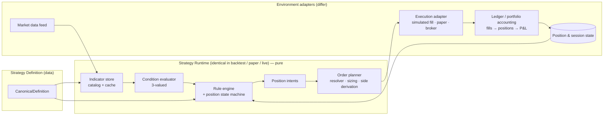

# Strategy Definition V2 — Architecture Specification

| | |
|---|---|
| Status | **Proposal — design only, awaiting architecture review** |
| Base | `dev` @ `e020da4` |
| Scope | Documentation only. No runtime, schema, API, UI or migration changes. |
| Supersedes | The V1 rule model in `backend/app/strategy_rules.py` (which says, correctly, that it must not be extended) |

---

## 1. Executive summary

V1 stores a strategy as `{entry: {type: "ema_crossover", action, direction, fast_period, slow_period}, exit?: {...}}` inside `StrategyVersion.configuration` (JSONB). Every part of the system that reads it — schema validation, `EmaCrossoverReferenceEngine`, `EmaCrossoverPaperAdapter`, the frontend `strategyConfig.ts` — re-implements the same EMA-specific interpretation.

**Proposal.** Keep JSONB and the immutable-version model. Replace the *shape* of the document with a versioned, closed-vocabulary, open-grammar definition made of five orthogonal parts:

```
Strategy Definition (schema_version = 2)
├── timeframe / evaluation        when are signals evaluated
├── positions{}                   WHAT can be held: named positions made of legs (+ sizing, risk)
├── rules[]                       WHEN to act: condition tree  →  ordered position operations
├── (conditions)                  all / any / not / compare / cross / edge over typed operands
└── (operands)                    price | constant | indicator(name, params, source, timeframe, output) | position field
```

Seven headline decisions (details and rationale in the sections noted):

1. **Rules, not Entry/Exit, are canonical** (§11). "Entry" and "Exit" remain the UI vocabulary, derived from the operations a rule performs — not stored.
2. **The definition never contains a closing order side** (§10). A position declares its direction once, on its legs. `open` / `close` / `increase` / `reduce` are *position operations*; order sides are derived by the runtime. This deletes V1's "exit must be opposite of entry" rule entirely.
3. **No `position_structure` enum** (§6). A position is a list of legs. "Straddle" is a *template* that expands into legs; "hedged" is a *relationship between positions*, not a structure.
4. **Conditions are a small typed expression tree with three-valued logic** (§8) — not just ALL/ANY/NOT over indicator comparisons.
5. **Indicators are inline operands with a canonical key**, resolved against a pinned, versioned catalog (§9). Reuse and caching are a runtime concern, not an authoring concern.
6. **Stored V2 documents are fully explicit** — no reader-side defaults (§13). V1's `LEGACY_*` default-filling is the pattern to *not* repeat.
7. **One runtime, three environments** (§14–15). The same pure strategy evaluator runs in backtest, paper and live; only market-data, fill and accounting adapters differ. A *capability manifest* per environment replaces ad-hoc rejections like the paper adapter's "supports only a buy entry".

The design is deliberately **wide in grammar, narrow in v2.0 vocabulary**: the schema can express options, hedges and scaling; the validator rejects, via declared capabilities, anything the runtime cannot yet do (§12, §20).

---

## 2. Current V1 architecture findings

Verified against `dev` @ `e020da4`.

| Area | Finding |
|---|---|
| **Storage** | `StrategyVersion` (`models/strategy.py`): `instrument_id` (nullable FK), `configuration` JSONB, `backtest_configuration` JSONB. Immutable by convention; `Backtest` snapshots both (`configuration_snapshot`, `backtest_configuration_snapshot`) and the instrument (`instrument_snapshot`). **This snapshotting is the right foundation and V2 depends on it.** |
| **Schema validation** | `StrategyVersionCreateRequest` takes `configuration: dict[str, Any]` and calls `strategy_rules.validate_rule_configuration`. Entry **periods are not validated at version creation** — only at run time (documented in the function's docstring). So an invalid EMA entry can become an immutable version. |
| **Rule parser** | `strategy_rules.py` (104 lines): `parse_entry_rule` / `parse_exit_rule` return `EmaCrossoverRule`. Rejects any `type != "ema_crossover"`. Legacy defaults (`buy`/`above`, `sell`/`below`) are applied by the *reader*, so the semantic of an old document depends on code, not on the document. |
| **Backtest service** | `services/backtest.py` hard-wires `EmaCrossoverReferenceEngine(provider.identifier)`. `timeframe`, `start_date`, `end_date`, `adjustment_policy` are read from `backtest_configuration`; `initial_capital` is required there. A `BacktestEngine` Protocol exists in `backtesting/contracts.py` (`run(configuration, backtest_configuration, candles)`) — a usable seam. |
| **Reference engine** | `EmaCrossoverReferenceEngine.run`: computes the whole EMA series up front, finds the **first** entry cross, then the **first** exit cross after it, produces **at most one trade**. Decimal arithmetic, SMA-seeded EMA, `None` during warm-up, cross = `prev_fast <= prev_slow and cur_fast > cur_slow` (and the mirror). Quantity = `initial_capital / entry_price` (**fractional, not lot-aware**). |
| **Fill timing** | Signal on candle *i* fills at `candles[i].close` — the **same bar's close**. A signal that is only knowable once the bar has closed fills at that bar's closing price. See §17; this is an optimistic fill assumption baked into V1 results. |
| **Paper adapter** | `EmaCrossoverPaperAdapter`: stateless, evaluates **only the latest candle**, buys only, rejects `action != "buy"`. Lot/tick-aware quantity (`floor(notional/price/lot)*lot`). Has its own copy of `_ema` and `_periods`. It does not read `exit` at all. |
| **Duplication** | EMA math exists twice (backtest, paper). Period validation exists three times (`strategy_rules.py`, `paper_execution/reference.py`, `strategyConfig.ts`). |
| **Frontend** | `strategyConfig.ts` builds/reads the V1 document and *re-implements* backend validation and the natural-language `describeRule`. UI and backend can drift. |
| **Instrument model** | `InstrumentType` = `equity` \| `index`. `is_tradeable`, `tick_size`, `lot_size` on `Instrument`. Index instruments are non-tradeable (paper adapter rejects them). Nothing models derivatives, expiries or option chains. |
| **Market data** | Candle = `{session_date, timestamp (UTC), OHLC Decimal, volume: int|None}`. `HistoricalCandleRequest` carries `timeframe`, `adjustment_policy`, trading `sessions`. Only the synthetic provider exists and it supports only `1d`. Provenance, dataset checksums and immutable stored candles already exist — good for reproducibility. |
| **Calendar** | `TradingSession{local_session_date, open_utc, close_utc, session_type, exchange_code}` — enough to anchor session-reset indicators (VWAP) and session boundaries later. |

---

## 3. V1 limitations

1. **One indicator, hard-coded** in schema, engine, adapter and UI.
2. **One position, one instrument, one trade per run.** The reference engine takes the first entry and first exit and stops.
3. **Action/side conflation.** V1 `action` is an order side on *both* entry and exit, and a validator keeps them opposite. That encodes "a position has two sides" into the schema; it cannot express scale-in (a second *buy* while long), partial exit, or multi-leg changes.
4. **No composition.** No AND/OR/NOT, no second condition.
5. **No risk concept** (stop, target, trailing).
6. **No position state in the model.** Nothing says what is currently held.
7. **Implicit semantics via reader defaults** (legacy fields) — historical meaning is coupled to current code.
8. **Same-bar-close fills**, fractional quantity, no costs/slippage in the model.
9. **Stateless paper execution** — cannot run anything with memory (scaling, partial exits, stops).
10. **Late validation** — entry periods only checked at run time.
11. **Duplicated interpretation** across four places; each new indicator would touch all four.

---

## 4. V2 architectural principles

1. **Definition ≠ runtime.** The definition says *what the strategy intends*; it must not know whether it is backtested, paper-traded or live.
2. **Open grammar, closed vocabulary.** Node *kinds* (`compare`, `cross`, `all`, `option`, …) are part of the schema and extensible additively. Which indicators/operators/instrument kinds are *usable* is a versioned, allow-listed catalog, enforced by validation and capability checks — never by `if type == ...` in an engine.
3. **Parse, don't interpret.** One module parses a stored document into a typed canonical model. Engines, adapters, UI and describers consume the model, never raw dicts.
4. **Explicit over implicit.** Stored V2 documents contain every semantically relevant value. Defaults are applied by the *writer* (UI/API normaliser) and stored.
5. **Intent / operation / order are three layers.** Strategy intent (rules) → position operation (`open`, `close`, …) → order side & type (derived by runtime, broker-agnostic until the execution adapter).
6. **Position structure is data, not a type.** Legs are the primitive. Named structures are labels/templates.
7. **No lookahead, by construction.** Evaluation timing and fill timing are explicit and separate (§17).
8. **Determinism.** Same definition + same data + same engine/catalog versions ⇒ bit-identical result. Decimal arithmetic with a defined numeric policy.
9. **Capabilities, not special cases.** Each environment declares what it supports; compatibility is a subset check on features the definition *requires*.
10. **Simplicity wins where the future is cheap to add.** Reserve grammar slots (documented, validator-rejected); do not build engines for them.
11. **Do not explode the database.** One JSONB document per version. Relational tables remain for entities.
12. **AI is a client of the validator**, never a source of truth (§20).
13. **The governing invariant.** A V2 canonical strategy definition is **deterministic, serializable, environment-independent, broker-independent, and replayable.** Concretely: it contains no capital amount, fill model, broker field, order type, runtime state, or hidden default; the same definition + dataset + engine/catalog versions always yields the same result; and anything that would break one of these properties belongs in environment/runtime configuration (e.g. `leg_failure_policy`, `fill_model`, costs), never in the definition. Any proposed field must pass this test.

---

## 5. Canonical Strategy Definition

### 5.1 Where it lives

Unchanged: `StrategyVersion.configuration` holds the definition. `instrument_id` stays and denotes the **primary instrument** (what the V1 UI calls the instrument; the symbol signals are computed on by default). `backtest_configuration` stays and holds **environment** settings only (§5.3).

### 5.2 Envelope and top level

```jsonc
{
  "schema": "algoprofitx.strategy-definition",
  "schema_version": 2,

  "timeframe": "1d",              // base signal timeframe (see §17 for why it is in the definition)
  "evaluation": "bar_close",      // only value in v2.0; "tick" is reserved

  "positions": { "<position_id>": Position },
  "rules":     [ Rule ]
}
```

Everything is strict: unknown keys are a validation error on write (an ignored key silently changes meaning).

### 5.3 Separation of concerns (answers question B)

| Concern | Lives in | Notes |
|---|---|---|
| **Strategy intent** | `rules[]` (+ `positions[].risk`) | what to do and when |
| **Market / instrument selection** | `StrategyVersion.instrument_id` (primary) + `positions[].legs[].instrument` selectors | *which* instrument; selectors resolved at runtime (§16) |
| **Indicator calculation** | **Not in the definition** — only *references* (`name`, `version`, `params`, `source`, `timeframe`, `output`). The math lives in the versioned catalog. | |
| **Condition evaluation** | Grammar in the definition; evaluator in the runtime | |
| **Position state** | **Never in the definition.** Runtime state, persisted by the runtime (§14) | |
| **Execution** | **Never in the definition.** No order types, no broker fields. Fill model, costs, slippage are environment config | |
| **Risk management** | Per-position **risk exits** (stop/target/trailing) are *intent* → in the definition. **Account-level** risk (max drawdown, kill switch, margin) is environment/allocation config | |
| **Capital / sizing amount** | Quantity (`shares` in v2.0; `contracts` reserved) is intent → definition. **Capital itself** (`initial_capital`, allocation notional) is environment | |
| **Backtest range, costs, fill model, adjustment policy** | `backtest_configuration` | |

Two notes against the brief's framing:

* **Timeframe belongs to the definition**, not `backtest_configuration` (where V1 reads it today). `EMA(9)` on `1d` and on `5m` are different strategies. Back-compat: for V2 the definition is authoritative; the service must reject a `backtest_configuration.timeframe` that disagrees.
* **Sizing is intent, and the primitive is quantity.** V1's implicit "100% of capital ÷ price" is capital-dependent, fractional and environment-coupled; a V2 definition instead states an explicit **quantity** (shares / contracts), so it stays environment-independent and replayable. Higher-level sizing (percent of allocation, risk-based) is a *later, explicit* layer. See §7.3.

### 5.4 Document identity

Every `Position`, `Leg`, `Rule` has a stable string `id` (slug, unique within the document). IDs are needed for: UI editing, trade/exit-reason attribution, diffing versions, and **deterministic order-intent idempotency keys** (`hash(strategy_version_id, rule_id, bar_timestamp, op_index)`), which live/paper execution will require.

A canonical hash (SHA-256 of RFC 8785-style canonical JSON) of the definition should be recorded with each backtest/execution for provenance. This needs no schema change (put it in `result_summary` / provenance).

---

## 6. Position structure model (question E)

### 6.1 Decision

Reject `position_structure ∈ {single_leg, multi_leg, hedged}`.

* `single_leg` vs `multi_leg` is just `len(legs)`; an enum duplicates (and can contradict) data.
* `hedged` is not a *shape* of a position at all. It is a **relationship between two positions** (a protective put hedges a long stock position). Modeling it as a structure forces "the hedge" and "the thing hedged" into one blob, which breaks independent sizing, independent exits, and partial hedge removal.

**Model:** a strategy declares named **positions**; each position is an ordered list of **legs**. Optional `template` is an annotation. Optional `hedges` links positions.

```jsonc
"positions": {
  "main": {
    "template": "long_straddle",          // OPTIONAL label/UI preset — never the source of truth
    "role": "core",                       // core | hedge   (hedge requires "hedges")
    "hedges": null,                       // position id this one protects, if role=hedge
    "legs":   [ Leg, ... ],               // §7 — the actual truth
    "sizing": { "unit": "...", "value": 100 },
    "risk":   { ... }                     // §10.4, optional
  }
}
```

### 6.2 How each structure fits

| Structure | Representation |
|---|---|
| Long | 1 position, 1 leg, `side: "buy"` |
| Short | 1 position, 1 leg, `side: "sell"` |
| Long straddle | 1 position, 2 legs: call/buy/ATM/nearest, put/buy/ATM/nearest |
| Short straddle | same, both `side: "sell"` |
| Long / short strangle | 2 legs, strike `moneyness` +N (OTM) for both |
| Spread / condor / custom | N legs; mixed sides |
| Protective put | **2 positions**: `core` (long equity) and `hedge` (long put, `role: hedge`, `hedges: "core"`) |

**Atomicity rule:** an operation on a position applies to *all* its legs as one **intent**. Atomicity of the *intent* is a strategy-level guarantee; atomicity of *execution* is **not** — a basket or legging-in can end with CALL filled and PUT rejected. The canonical consequence is that position status is **not binary**: see §14.4 (state layers, incomplete leg sets, partial-failure policy). Operations on a *subset* of legs (roll one side, close one wing) use an optional `legs: [...]` selector on the op, reserved for later (§10).

**Active-position invariant (V2.0 restriction).** A definition may declare multiple named positions (the model is expressive now), but V2.0 *runtimes* restrict which can be active simultaneously: at most **one `core` position active at a time**, plus any number of `hedge` positions attached to it. This is declared as capabilities (`positions.multiple_core`, `positions.hedge`) — so the restriction lives in the capability manifest, not in the schema, and lifting it later is not a schema change. Portfolio-level orchestration across independent core positions is an explicit non-goal. Long-and-short in one strategy is therefore expressible (two `core` positions) but **not runnable** until `positions.multiple_core` exists.

`template` expansion is a UI/authoring concern: choosing "Long Straddle" in the builder **writes the expanded legs**. The validator may check that a declared `template` matches its legs (warning), but the runtime ignores it.

---

## 7. Leg model (question F)

```jsonc
Leg = {
  "id": "call",
  "instrument": InstrumentSelector,
  "side": "buy" | "sell",                  // the leg's OPENING direction (see §10.1)
  "quantity": Quantity,                    // multiplier of the position's sizing, default 1
  "role": "core" | "wing" | "hedge" | ...  // free classification for analytics/validation (optional)
}
```

### 7.1 InstrumentSelector

A selector *describes* an instrument; a **resolver** (runtime, §16) turns it into a concrete tradeable contract at a point in time. The definition never contains a broker symbol or token.

```jsonc
// v2.0 — the only kind implemented
{ "kind": "primary" }                       // = StrategyVersion.instrument_id (spot/cash equity)

// reserved grammar — validator rejects until the capability exists
{ "kind": "future",
  "underlying": { "kind": "primary" },
  "expiry": ExpirySelector }

{ "kind": "option",
  "underlying": { "kind": "primary" },       // may be a non-tradeable INDEX: signals on the index, trade its options
  "option_type": "call" | "put",
  "strike": StrikeSelector,
  "expiry": ExpirySelector }
```

```jsonc
StrikeSelector =
  { "mode": "moneyness", "steps": 0 }        // 0=ATM, +n = n strike-steps OTM, -n = ITM  (symmetric for call/put!)
| { "mode": "absolute",  "strike": 22500 }
| { "mode": "percent_otm", "value": 2.0 }    // reserved
| { "mode": "delta",     "target": 0.25 }    // reserved (needs greeks)

ExpirySelector =
  { "mode": "nearest" }                      // first expiry >= entry date (optionally with min_days)
| { "mode": "nth", "n": 2, "cycle": "weekly" | "monthly" }
| { "mode": "absolute", "date": "2026-11-26" }
```

Why `moneyness` signed steps: "OTM call" and "OTM put" are on opposite sides of spot; encoding OTM-ness relative to the *option type* lets a strangle's two legs share one selector and survive a UI change of option type.

### 7.2 Resolution semantics (must be fixed now)

* A leg is resolved **once, at the bar its opening operation is executed**, using data known at that time. The concrete contract is then stored in **position state** and not re-resolved while the position is open. (Otherwise "ATM" drifts with spot while holding.)
* `increase` uses the already-resolved contracts; it does not re-select strikes.
* Resolution needs **point-in-time** contract master data (strike grid, expiries, **lot size as of that date** — NSE lot sizes are revised). This is a data prerequisite, not a schema one.

### 7.3 Quantity and sizing

```jsonc
Sizing =
  { "unit": "shares", "value": 50 }                  // v2.0 - the ONLY authorable unit; REQUIRED, no default
| { "unit": "contracts", "value": 1 }               // reserved (derivatives; lots x lot size resolved by runtime)
| { "unit": "match_position", "position": "core", "ratio": 1 }   // reserved - hedge sizing
// Not authorable in V2 documents (validator rejects):
//   { "unit": "percent_of_allocation", "value": 100 }  - produced ONLY by the V1 adapter, in memory,
//   to reproduce V1's all-in sizing (parity, section 13.2)
```

**V2.0 sizing decision (review #32):** one deterministic model — an explicit quantity, always present, never defaulted. Anything richer (percent of allocation, volatility/risk-based, notional) is a later, explicit sizing unit that compiles *down to* quantity at order-planning time; adding one is additive. How an allocation's notional maps to a quantity for a strategy that declares a fixed quantity (cap, reject, or scale) is an **allocation/execution-policy** question, not a definition question.

A leg's `quantity` is a multiplier on the position's sizing (default 1), e.g. a 1:2 ratio spread. Rounding to lot/tick is **runtime**, using instrument metadata — not the definition.

> **Risk flagged:** short option legs have unbounded loss and need a *margin* model. Quantity alone does not bound their risk, and capital-based sizing is meaningless for them without margin rules. Short-option support is therefore gated on a margin/capital model, not on the schema (§22).

---

## 8. Condition / expression model (questions A, G)

### 8.1 Is ALL/ANY/NOT over comparisons sufficient? No.

It lacks (a) **typed operands** (so `price`, `volume`, constants, indicator outputs, and *position fields* are all first-class), (b) **event semantics** (cross), (c) **edge detection** (needed for scale-in, Case 11), (d) **missing-data semantics**, and (e) a **reserved temporal construct**. It does *not* need a general-purpose expression language with arithmetic, variables and user functions. The proposal is a **closed, typed tree**:

```
Condition  := all{of:[Condition]} | any{of:[Condition]} | not{of:Condition}
            | compare{op, left:Operand, right:Operand}
            | cross{dir, left:Operand, right:Operand}
            | edge{dir:"rising", of:Condition}                 // v2.0
            | within{bars:N, of:Condition}                     // RESERVED (lookback)
            | for_bars{bars:N, of:Condition}                   // RESERVED

Operand    := price{field}                                    // open|high|low|close|volume
            | constant{value}
            | indicator{name, version, params, source?, timeframe?, output}
            | position{position, field}                        // RESERVED: entry_price, unrealized_pct, bars_in_trade
            | arith{op, left, right}                           // RESERVED: e.g. close - ema(20)
```

Nodes carry a `kind` discriminator. A node of unknown `kind` is a *semantic* error ("not supported by schema_version 2 / this capability set"), not a parse crash, so new nodes are additive.

### 8.2 Operator semantics (precise)

All evaluated on **closed bars** (§17). Let `x[t]`, `y[t]` be operand values on bar *t*.

| Node | Definition | Needs |
|---|---|---|
| `compare gt/gte/lt/lte` | `x[t] op y[t]` | current only |
| `compare eq` | exact equality | **Restricted**: allowed only where both operands are discrete/exact (e.g. integers). On indicator/price series it is rejected by the validator — float/decimal equality is a trap. |
| `cross above` | `x[t-1] <= y[t-1] AND x[t] > y[t]` | current + previous |
| `cross below` | `x[t-1] >= y[t-1] AND x[t] < y[t]` | current + previous |
| `edge rising` | `C[t] AND NOT C[t-1]` | evaluates child at t and t−1 |

`cross` uses exactly V1's convention (`<=` then `>`), so V1 EMA behaviour is reproducible. `cross` is **stateless**: it needs the previous *value*, not stored event state. It is the event form of `compare`; `edge` generalises it to any condition.

**Cross-event state is not stored in the definition.** A cross is true on one bar only. Combining an event with a *level* in `all` (EMA cross AND RSI>50) is well-defined on the same bar. Combining two *events* that must have happened "recently, in any order" needs `within{bars}` — reserved, because it is the first construct that needs a rolling window of *condition* history; build it when a real strategy requires it.

### 8.3 Missing data: three-valued logic (a correctness requirement)

Operands can be **undefined** (indicator warm-up, missing candle, `volume: None`). Condition results are therefore `true | false | unknown`:

* `compare`/`cross` with any undefined operand → `unknown`.
* `all`: any `false` → false; else any `unknown` → unknown; else true. `any`: dual. `not(unknown) = unknown`.
* **A rule fires only on strictly `true`.**

Without this, `not(rsi < 30)` is *true* during RSI warm-up and the strategy would trade on garbage. (V1 avoids this only because it has no `not`.) This must be specified now because adding `not` later retroactively changes the meaning of every stored definition.

### 8.4 Why not a full expression AST now

Arithmetic (`close - ema(20) > 2*atr(14)`) is the one thing users will request soonest. The grammar reserves `arith` as an operand kind so it is additive. It is *not* built now: it enlarges the validation surface (units, division by zero, type of result) before any shipped strategy needs it.

### 8.5 References

No named-variable/`let` references in v2.0. Indicators are inline operands (§9). If composite sub-conditions get reused often, add named `conditions{}` + `{kind:"ref"}` later; the document-level `id` convention (§5.4) already leaves room.

---

## 9. Indicator model

### 9.1 Indicator reference (inside an operand)

```jsonc
{ "kind": "indicator",
  "name": "bollinger", "version": 1,
  "params": { "period": 20, "stddev": 2 },
  "source": { "kind": "price", "field": "close" },     // input series — may itself be an indicator operand
  "timeframe": "1d",                                   // default = definition timeframe
  "output": "lower" }                                  // "value" for single-output indicators
```

Because `source` is an operand, `EMA(RSI(14), 9)` works with no new concept.

### 9.2 Inline vs declared registry

Considered: a top-level `indicators{id: spec}` map referenced by id. **Decision: inline operands, deduplicated at runtime by a canonical key** `hash(name, version, params, source-key, timeframe)` (output is *not* part of the key — all outputs of one calculation share it).

| | Inline + canonical key (chosen) | Declared registry |
|---|---|---|
| Self-contained / no dangling refs | yes | needs ref validation |
| Dedup, caching, dependency graph | runtime, via key | by author |
| Nested sources | natural | indirection |
| Verbosity | high — but the UI writes it, humans don't | low |
| Two places to edit | no | yes |

"Reusable primitives" is satisfied by the **catalog** (one implementation per indicator) and the runtime cache, not by authoring-time naming.

### 9.3 Catalog (code, not data in the definition)

Each entry is immutable once published:

```
IndicatorSpec(name, version)
  params_schema     typed, bounded (period ∈ [1, 5000], …)
  outputs           ["value"] | ["upper","middle","lower"] | ...
  source_arity      price-only | any-series
  warmup(params)    number of bars before first defined output
  min_timeframe     e.g. VWAP requires intraday bars
  anchor            none | session   (VWAP resets per trading session)
  compute(series)   pure, deterministic, Decimal
```

* **Semantics are versioned.** `ema@1` = SMA-seeded (as V1). Changing seeding is `ema@2`. Stored definitions pin `version`, so old results stay reproducible.
* **Warm-up** is derived from the catalog; the runtime computes the *maximum warm-up over all referenced indicators* (including nested sources) and requests that much history before the evaluation start. Undefined values propagate as `unknown` (§8.3).
* **Determinism:** compute in `Decimal` with a fixed context and documented rounding. A future vectorised/float implementation must pass golden-vector parity tests against the Decimal reference within a stated tolerance; the Decimal one is the oracle.
* **Batch vs incremental:** the interface is "values for bars up to *t*" and must not read bars after *t*. Batch (backtest) and incremental (live) implementations must agree bar-for-bar — enforce with a property test.
* **Multi-timeframe:** a higher-timeframe indicator is visible at base bar *t* only through the **last completed** higher-timeframe bar (no peeking at the in-progress bar).
* **Missing candles:** policy is a market-data concern (gap = error / forward-fill / flagged); the indicator layer receives a validated, ordered series and never interpolates silently.

V2.0 catalog: `ema@1`, `sma@1`, `rsi@1`. `vwap`, `bollinger` are specified here and implemented later (they require intraday data and multi-output respectively — both already designed for).

---

## 10. Action model (question D)

### 10.1 Three layers

```
Strategy intent        "get long when trend turns up"          rule + condition
        ↓
Position operation     open | close | increase | reduce | …     in the definition
        ↓
Order side/type        BUY / SELL, MKT / LIMIT / bracket      derived by runtime, never in the definition
```

### 10.2 Comparison of the candidate models

| Model | Verdict |
|---|---|
| `{side: "buy"}` (V1) | Conflates order side with intent; cannot say "reduce" vs "add"; forces the exit to carry a redundant opposite side that must be validated. **Reject.** |
| `{intent: "open", side: "buy"}` | Better, but `side` on `close`/`reduce` is redundant (determined by what is held) and can contradict it. **Reject for non-open ops.** |
| `{operation: "increase_position", direction: "long"}` | `direction` is again redundant with the position's legs, and a verb-per-op enum with embedded direction doesn't extend to multi-leg. **Reject.** |
| **Chosen:** direction lives on the **leg** (declared once); actions are `{op, position, [amount]}` | Nothing redundant; nothing to contradict; multi-leg works unchanged. |

### 10.3 Chosen model

```jsonc
Action =
  { "op": "open",     "position": "main" }
| { "op": "close",    "position": "main" }
| { "op": "increase", "position": "main", "amount": Amount }
| { "op": "reduce",   "position": "main", "amount": Amount }
// reserved:
| { "op": "replace",  "position": "main", "legs": ["call"], "with": Leg }     // roll / adjust a leg
| { "op": "adjust",   ... }

Amount = { "unit": "fraction_of_open", "value": 0.5 }      // 50% of what is currently open
       | { "unit": "sizing_unit",      "value": 1 }        // same unit as the position's sizing
```

* `side` on a leg means **opening direction**: `buy` = long exposure, `sell` = short exposure. The runtime derives the order side: `open`/`increase` ⇒ leg side; `close`/`reduce` ⇒ opposite of leg side. The V1 "exit must be opposite of entry" check disappears — it cannot be violated because exits carry no side.
* **Hedge** is not an op. It is `open` on a position with `role: "hedge"` / `hedges: <id>`, plus a rule. This keeps the op set minimal.
* An op's optional `legs: [ids]` narrows it to a subset of legs (reserved; whole position by default).
* **`increase` / `reduce` invariants** (stated now, implemented later):
  1. A position has one **effective size** `S` in its sizing unit and **fixed leg ratios** (`leg.quantity` multipliers) set at `open`. `increase`/`reduce` change `S`; they never change ratios and never re-resolve contracts (§7.2).
  2. `fraction_of_open` is always a fraction of the **current** effective size at *evaluation time*, not of the original. After `open 100`, `reduce 0.5` → 50, `increase +50` → 100, `reduce 0.5` → 50. Repeated operations compose multiplicatively on the current size.
  3. `sizing_unit` amounts are absolute in the position's sizing unit and are added to / subtracted from `S`.
  4. After rounding to lot/tick the planner may be unable to honour the ratios exactly; the policy is **round each leg down to a whole lot and preserve ratios, else skip the op with `skipped: below_lot`**.
  5. `reduce` to ≤ 0 is equivalent to `close`; `reduce` can never flip direction.
  6. `limits.max_fires_per_position` counters are reset when the position returns to `flat`.
* **Op preconditions are evaluated against the ledger-derived position status** (§14.4): `open` requires `flat`; `close`/`reduce`/`increase` require `open` (or `degraded`, see §14.4). A position that is `opening`/`closing` accepts no new operation. An op whose precondition fails is **skipped and recorded** (`skipped: already_open` / `already_opening`), not an error. An `open` *operation* is **intent**; it does not mean the position *is* open until fills say so — the same condition legitimately recurs while a position is held. That makes `edge`/`limits` the tools for "only once", not guards on every rule.
* **Execution atomicity of `then`:** actions in one rule's `then` list are an ordered group evaluated against one snapshot.

### 10.4 Risk exits (Cases 14)

Stops/targets are *intent* but need **price-level** semantics (touch within a bar via high/low, gap handling, trailing high-water mark). Modeling them as ordinary conditions on bar close would make live execution (resting stop/bracket orders) and backtest diverge. They are therefore a per-position block:

```jsonc
"risk": {
  "stop_loss":   { "kind": "percent", "value": 2.0, "basis": { "kind": "leg_price", "leg": "stock" } },
  "take_profit": { "kind": "percent", "value": 5.0, "basis": { "kind": "leg_price", "leg": "stock" } },
  "trailing":    { "kind": "percent", "value": 1.5, "basis": { ... } }   // reserved
}
// reaction is always: close the position; exit reason recorded as stop_loss/take_profit
```

**The trigger reference (`basis`) is part of the canonical meaning and is mandatory** — "percent from entry" is meaningless for a multi-leg position without saying *entry of what*. The bases:

| `basis.kind` | Trigger variable | Valid for | v2.0 |
|---|---|---|---|
| `leg_price` (`leg`) | price of one named leg vs that leg's entry fill price (long: falls below; short: rises above) | any position, typically single-leg | **yes** (the V1-equivalent case) |
| `position_pnl_pct` | position unrealised P&L (all legs, marked to market, **net of entry costs**) ÷ **entry gross value** (Σ over legs of \|entry price × quantity × multiplier\|; for net-credit positions this is the gross premium, not the net credit) | multi-leg | reserved |
| `position_pnl_amount` | same P&L, absolute currency amount (`value` is currency) | multi-leg | reserved |
| `underlying_price` | price of the underlying (primary or named) vs its price at the entry fill; direction given by `direction: "against" \| "favour"` | options structures | reserved |
| `net_premium` | net debit/credit paid/received at entry vs current net mark (e.g. "stop at 2× credit received") | spreads, short premium | reserved |

**Implementation obligation (review #32): in V2.0 only `leg_price` is implemented.** The other rows document *meaning only*; they create no implementation obligation, the validator rejects them via capabilities, and they may be refined before first implementation without a schema bump.

Direction ("loss side" for stops, "profit side" for targets) is derived from the basis variable and the side of the position, never from the sign of `value`. A `risk` entry whose `basis` is not valid for the position's legs (e.g. `leg_price` naming a missing leg, `position_pnl_pct` on one leg is allowed but redundant) is a layer-3 validation error.

Tie-break when both are touched in one bar and finer data is unavailable: **stop first** (conservative). Documented, not configurable in v2.0. Time/bars-based exits are ordinary conditions once the `position` operand exists.

---

## 11. Rule lifecycle model (question C)

### 11.1 Entry/Exit: keep as UI vocabulary, not as schema

```jsonc
Rule = {
  "id": "enter_long",
  "label": "Buy on trend up",                      // optional, display
  "when": Condition,
  "then": [ Action, ... ],
  "when_position": { "main": "flat" },             // OPTIONAL extra guard on position state: flat | open
  "priority": 100,                                 // lower runs first; default by declaration order
  "limits": { "max_fires_per_position": 1 }        // OPTIONAL, runtime counter in position state
}
```

A "phase/event" field (`phase: "entry"`) was considered and **rejected**: it adds a second source of truth for what the actions already say, and a lifecycle enum (`entry|monitor|adjust|exit`) bakes today's imagination into the schema. The ledger-derived *position status* (§14.4) is the lifecycle; rules express intent to transition it.

Rules express **intent**; they do not assert that a position *is* in a state. The lifecycle below is the **ledger-derived position status** (§14.4), driven by fills:

```
        open intent        all legs filled
 FLAT ─────────────► OPENING ─────────────► OPEN ◄──── increase / reduce (filled) ───┐
  ▲                     │ some legs failed     │ └──────────────────────────────────────┘
  │                     ▼                      │ close intent
  │                 DEGRADED ◄─ (incomplete    ▼
  │                     │        leg set)   CLOSING ──(some legs unfilled)──► DEGRADED
  └──── all legs flat ──┴────────────────────┘
```

### 11.2 UI projection (derived, never stored)

* **Entry** = rules whose actions include `open`.
* **Exit** = rules whose actions include `close` (+ the position's `risk` block).
* **Adjust / Scale** = rules with `increase` / `reduce`.

A definition the simple builder cannot faithfully project (e.g. two rules mixing `open` and `close`) is shown read-only via the shared describer (§19).

### 11.3 Evaluation order and conflicts (must be deterministic)

Per closed bar, on one immutable snapshot (market data ≤ *t*, position state before *t*):

1. Evaluate **risk exits** (price-level) for each open position.
2. Evaluate **rules** in `priority`, then declaration order; collect actions.
3. Resolve conflicts per position: `close` > `reduce` > `increase` > `open`; after a `close`, remaining ops on that position **this bar** are dropped (no same-bar flip-flop); two ops of equal rank on one position collapse to the first.
4. Pass the resulting **position intents** to the order planner.

Rules never see each other's effects within a bar. Multiple exit conditions (Case 14) are *either* one rule with `any{...}` *or* several rules — equivalent in effect; separate rules additionally give **per-rule exit-reason attribution**, which is why they are preferred in the UI.

---

## 12. Validation architecture

Five separate layers, separate code, separate error classes, separate moments. Each layer's output is structured (`path`, `code`, `message`, `severity`) so the UI can highlight the offending node.

| # | Layer | Question | When | Examples | Lives in |
|---|---|---|---|---|---|
| 1 | **Schema** | Is the document structurally valid? | API write | wrong type, unknown key, bad `kind`, `schema_version` missing | pydantic v2 discriminated unions (JSON Schema exported for the UI) |
| 2 | **Semantic** | Does it make sense, independent of any environment? | Version create | indicator param out of range, unknown indicator/version, `eq` on a series, `not` of nothing, dangling `position`/`hedges` id, duplicate ids, `source` cycle, `cross` operands of incompatible units, `vwap` on a daily timeframe | pure functions over the model + catalog |
| 3 | **Position** | Is the lifecycle coherent? | Version create | rule `close`s a position no rule can `open`; `hedges` target missing; hedge can outlive its parent (warning); `reduce` fraction ∉ (0,1]; leg combination invalid for a template | static analysis of rules × positions |
| 4 | **Execution/capability** | Can *this environment* run it? | Backtest request, allocation, paper/live deploy | option legs on paper; instrument not tradeable; short without margin support; unsupported timeframe | `required_capabilities(defn) ⊆ env.capabilities` |
| 5 | **Runtime** | Does the data allow it *now*? | During a run | insufficient history for warm-up, missing/gapped candle, no contract at selected strike, op skipped by state machine | engine; emitted as run events/diagnostics, not exceptions |

Rules of the road:

* Layers 1–3 are **environment-free** and must pass before an immutable version is created. (This fixes V1's "periods only checked at run time".)
* Layer 4 is **where V1's ad-hoc paper rejection goes**: the definition is valid; this runtime just cannot do it yet, and says so in a structured, user-presentable way (and can be shown in the marketplace as "backtest only").
* A *runtime* failure never retroactively invalidates a version.
* `required_capabilities` is computed by walking the model: e.g. `{ "leg.instrument.option", "indicator.vwap@1", "op.reduce", "risk.stop_loss", "short_sell" }`.

---

## 13. Versioning and backward compatibility

### 13.1 Rules

* V1 versions are **immutable historical artifacts. They are never rewritten**, not even to "migrate" them.
* A V2 document carries `schema_version: 2`. **A document with no `schema_version` is V1.** The version discriminator exists **in both places** (decision, review #32): self-describing in the JSON (`schema_version`) *and* as an explicit column on `StrategyVersion` for persistence/query visibility. Historical rows are backfilled by a **data-only step that records the version (1) without touching `configuration`**; the JSON of V1 versions is never rewritten. Column and JSON must agree — checked on write; a mismatch is a layer-1 error. The column is introduced in the phase that wires V2 into the API (Phase 6), not in Phase 1.
* A single entry point — `load_definition(configuration) -> CanonicalDefinition` — dispatches on `schema_version`:
  * `2` → parse + validate.
  * *absent* → **V1 adapter**: lifts the V1 document, *in memory only*, into the canonical model (one `main` position with a `buy`/`sell` leg from `entry.action`, an entry rule `cross` on two `ema` indicators, optionally an exit rule `close`). All legacy defaulting (`buy`/`above`…) lives in this adapter and nowhere else.
* Engines consume only `CanonicalDefinition`. V1 and V2 therefore share one engine; the V1-specific engine and paper adapter become **oracles** for parity tests, then are retired.

### 13.2 Fill-model parity

V1 results assume "fill at the signal bar's close". The V1 adapter therefore tags lifted definitions with `fill_model: "same_bar_close"` *in the loaded model* (environment default for V1 only). V2 backtests state their fill model **explicitly** in `backtest_configuration` (`fill_model` is required — no hidden engine default); the V2.0 creator writes `next_bar_open`. Note this is a deliberate change of convention, **not** the current one: V1 is `same_bar_close`. **Parity requirement:** the V2 engine, given a lifted V1 document, `same_bar_close`, and the V1 fixtures, must reproduce `EmaCrossoverReferenceEngine` output exactly. The parity fixture locks down, for every fixture: **trade count; per-trade side, quantity, entry/exit price and pnl; signal timestamp and fill timestamp (equal under `same_bar_close`, asserted as such); exit reason (`rule:exit` vs end-of-data); final equity; and the full equity-curve strings.** Where a V1 concept does not map (e.g. V1 has no exit reason; end-of-data close is an engine artefact), the mapping is written into the fixture, not left implicit. Signal/fill timestamps are added as *additive* V2 result fields so V1 consumers are unaffected. This is the single most important regression test for the migration, and the gate for retiring the V1 engines.

### 13.3 Evolution within V2

* **Additive** changes (new indicator, new `kind`, new op) do not bump `schema_version`; they appear as new **capabilities/features** and old documents simply never reference them.
* A **breaking** change (meaning of an existing field changes) ⇒ `schema_version: 3` with its own parser; V2 documents stay readable by the V2 parser forever.
* **Semantics pinning:** indicators pin `version`; the schema pins numeric policy and evaluation semantics via `schema_version`. A result is reproducible from `(definition hash, engine id, catalog versions, dataset checksum)` — most of which the `Backtest` row already records.
* **Explicit-only storage:** the writer (builder / API normaliser) fills every default and stores the full form. The reader never defaults. This is the lesson of V1's `LEGACY_*` constants.

### 13.4 API

`StrategyVersionCreateRequest.configuration` dispatches on `schema_version`. **Decision (review #32):** all existing V1 versions are preserved forever and never migrated. An explicit **cutoff** for *creating* new V1-shaped versions is introduced only once the V2 creator flow is production-ready; until then both are accepted. The cutoff is a dated product decision, not a schema change. The version response remains `configuration: dict` (no breaking API change).

---

## 14. Backtest / runtime architecture

### 14.1 Challenge to the proposed decomposition

The proposal's `Indicator Engine → Condition Evaluator → Position Manager → Action/Order Intent Engine → Portfolio/P&L Engine` is a good vocabulary but conflates things that should be separated and misses two components:

* **Missing: Order Planner / Instrument Resolver.** Turning "open the straddle" into concrete contract orders (resolve strikes/expiries, derive sides, round to lots/ticks, apply sizing) is neither condition evaluation nor position tracking nor fills. It is where multi-leg complexity lands.
* **Missing: persisted position/session state.** Scaling, partial exits, stops and live trading require memory across bars *and across process restarts*. The current paper adapter has none.
* **Conflated: "Position Manager".** Split into the **status machine** (what transitions are legal; pure, reads ledger status) and the **ledger** (what is actually held at what cost; fed only by fill events) — see §14.4.
* **Indicator Engine is a library**, not a pipeline stage: a pure, cached function of the series.

### 14.2 Proposed decomposition



| Component | Responsibility | Pure? | Differs per env? |
|---|---|---|---|
| **Strategy Definition** | Data (§5) | — | no |
| **Definition loader / validator** | parse, normalise, validate L1–L3, compute required capabilities | yes | no |
| **Market-data feed** | ordered, validated candles for (instrument, timeframe, range) incl. warm-up | I/O | **yes** (historical / live) |
| **Indicator store** | catalog compute + canonical-key cache + warm-up | yes | no |
| **Condition evaluator** | tree → true/false/unknown | yes | no |
| **Rule engine + state machine** | rules + position state → position intents (conflict resolution §11.3) | yes | no |
| **Order planner** | intents → order intents: resolve legs, size, derive sides, lot/tick rounding | yes (given resolver) | no (resolver backed by data) |
| **Execution adapter** | order intents → fills (+ costs, slippage) | I/O | **yes**: simulated / paper / broker |
| **Ledger** | fills → positions, cash, realised/unrealised P&L, equity curve | yes | no |
| **Position/session state** | three layers — intent, order, ledger (§14.4); serialisable; deterministic order-intent IDs | storage | persisted in paper/live, in-memory in backtest |
| **Orchestrator** | steps the loop; backtest = iterate history, paper/live = on each bar close | — | **yes** |

Properties this buys:

* **Backtest ≡ paper ≡ live up to adapters.** Divergence bugs (V1's duplicated EMA math) become structurally impossible.
* The strategy runtime is **side-effect-free**: golden tests feed candles and assert intents.
* Idempotency/resume for live: replaying the same bar yields the same intents with the same deterministic IDs.

### 14.3 Backtest service in V2

```
BacktestService
  load_definition(version.configuration)        # §13
  check capabilities(env=backtest)               # L4
  history = MarketDataProvider.load(range - warmup)
  for bar in history: runtime.step(bar) → intents → SimulatedExecution → Ledger
  result = Ledger.summary()                      # same BacktestExecutionResult shape, extended
```

The existing `BacktestEngine` Protocol (`run(configuration, backtest_configuration, candles)`) can remain the *outer* seam: a `StrategyRuntimeEngine` implements it, so the service/API change is minimal. Result gets additive fields (per-trade `exit_reason`, per-leg detail, `engine_version`), keeping the V1 `trades`/`equity_curve` shape for the single-position case.

### 14.4 State layers, incomplete positions, and the order-intent contract

**Three distinct state layers** (conflating them is what makes "open" ambiguous):

| Layer | Owner | Meaning | Mutated by |
|---|---|---|---|
| **Intent state** (desired) | rule engine | what the strategy currently *wants*: per position, `desired ∈ {flat, open(size S)}` and the op that produced it | rule evaluation |
| **Order state** (working) | execution adapter | order intents and their lifecycle: `created → submitted → acknowledged → partially_filled → filled \| rejected \| cancelled \| expired` | adapter events |
| **Ledger state** (actual) | ledger | what is *filled and held*: per-leg quantity, average price, costs; derived position **status** | fills only |

Only ledger state may answer "is the position open?". The rule engine's preconditions (§10.3) read **status**, not intent.

**Position status** (derived from per-leg filled quantity vs. target):

| Status | Definition |
|---|---|
| `flat` | every leg filled quantity = 0 and no working open/increase orders |
| `opening` | an open/increase intent has working orders |
| `open` | all legs at target size within tolerance, no working orders |
| `degraded` | **incomplete leg set**: legs' filled quantities do not match fixed leg ratios and nothing is working (e.g. CALL filled, PUT rejected) |
| `closing` | a close/reduce intent has working orders |

`partially_open` / `partially_closed` are not separate statuses: they are `opening`/`closing` (orders still working) or `degraded` (nothing working, ratios broken). The ledger always records **per-leg** quantities, so an incomplete set is representable exactly; position-level P&L is always the sum over legs.

**Partial-failure policy.** What to do on `degraded` is an **execution policy**, not strategy intent. `leg_failure_policy` is **runtime/execution configuration** (environment config for backtest/paper, adapter config for live): it is **not part of the portable canonical strategy definition**, never appears in `StrategyVersion.configuration`, and changing it never changes a version's identity or hash. The strategy states which position it wants; the environment decides how to recover from a failed leg.
* `unwind` *(default)* — submit closing orders for the filled legs; position returns to `flat`; the run records `open_failed: leg_rejected`. Rules may re-fire next bar subject to `limits`.
* `retry(n)` — re-submit the missing legs up to `n` times with the same intent id, then `unwind`.
* `hold_and_alert` — leave `degraded`; only `close` is accepted; surfaced to the user (live-only in practice).

Backtest simulation assumes complete fills unless its fill model injects rejects; the **status machine and ledger are the same code** in every environment, so behaviour on partial fills is specified once.

**Order-intent contract (the seam all environments share).** The order planner emits, and every execution adapter consumes, exactly:

```jsonc
OrderIntent = {
  "intent_id":  "<hash(strategy_version_id, rule_id|risk_id, bar_ts, op_index, leg_id)>",  // deterministic
  "group_id":   "<hash(... op_index)>",          // legs of one operation share a group (basket)
  "position":   "main", "leg": "call", "op": "open",
  "contract":   ResolvedContract,                 // §16 — broker-agnostic
  "side": "buy" | "sell", "quantity": "50",       // derived by the planner (§10.1)
  "constraints": { "time_in_force": "bar", "limit_price": null, "reference_price": "..." },
  "group_policy": "all_or_unwind"                 // from leg_failure_policy
}
```

Adapters return a stream of **events** against `intent_id`:

```jsonc
{ "intent_id": "...", "type": "accepted" | "rejected" | "partial_fill" | "filled" | "cancelled" | "expired",
  "filled_qty": "...", "price": "...", "fees": "...", "ts": "<UTC>", "reason": "<code>" }
```

Contract rules:
1. **Idempotency:** an adapter must treat a repeated `intent_id` as the same order (no double submit). Replaying a bar after a crash regenerates identical ids.
2. **Retries** reuse `intent_id` with an incrementing `attempt`; the ledger de-duplicates events by `(intent_id, event_seq)`.
3. **Ledger is fed only by events**, never by intents. Backtest's simulated execution emits the same event types.
4. **Reconciliation** (live): periodically compare the ledger to broker positions; a mismatch produces a `reconciliation_diff` event, moves the position to `degraded`, and is never silently overwritten. The reconciliation interface is part of the adapter contract, defined now (empty in backtest/paper).
5. **No broker field** appears in `OrderIntent`; broker ids are mapped inside the live adapter and stored only in the adapter's own records.
6. **Rejects and partial fills are first-class events**, not exceptions.

This contract is the single boundary replacing V1's duplicated backtest/paper interpretation: backtest, paper and live differ *only* in who produces the events.

---

## 15. Paper / live execution boundary

* The runtime emits **order intents** (broker-agnostic: instrument contract, side, quantity, intent id, rule id). *Nothing before the execution adapter knows a broker.*
* **Paper adapter:** simulated fills from the latest bar(s) with the same tick/lot rounding; **must persist state** to support anything beyond one-shot entry. This is the largest functional gap between V1 paper and V2.
* **Live adapter (future):** maps order intents → broker API; owns order types, bracket orders for `risk` exits, partial-fill handling, rejects, reconciliation against broker positions. Broker-specific tokens/IDs exist **only** here and in an instrument-mapping table (already modeled for market-data vendors: `InstrumentVendorMapping`).
* **Capability manifest per environment**, e.g.:

```jsonc
{ "environment": "paper", "version": 1,
  "features": ["leg.instrument.primary", "op.open", "op.close", "short_sell", "indicator.ema@1"] }
```

**Capabilities are compound.** A capability name may stand for several prerequisites across *different layers*. Each capability declares its prerequisites, and the checker expands them transitively before the subset test. Three layers of provision are kept distinct so a failure says *which* is missing:

| Layer | Provided by | Examples |
|---|---|---|
| **Implementation** (code) | the runtime | `indicator.vwap@1`, `op.reduce`, `risk.basis.leg_price` |
| **Data** | market-data / reference-data providers for the run | `data.intraday_bars`, `data.session_anchor`, `data.option_chain`, `data.option_prices`, `data.lot_size_history` |
| **Environment** | execution/accounting environment | `short_sell`, `margin.short_options`, `multi_leg.basket`, `positions.hedge` |

```jsonc
"capability_graph": {
  "indicator.vwap@1": ["data.intraday_bars", "data.session_anchor"],
  "leg.instrument.option": ["resolver.option", "data.option_chain", "data.option_prices", "data.lot_size_history"],
  "leg.side.sell+option":  ["margin.short_options"]
}
```

The result of the check is the set of **unsatisfied leaves** grouped by layer (e.g. "missing data: `data.intraday_bars`") — which is what the UI can show ("backtest unavailable: needs intraday data" vs "paper unavailable: execution not supported").

Allocation/deploy checks `required ⊆ provided` after expansion. Today's matrix, expressed as capabilities rather than code branches:

| | Backtest (V2 engine, phase 2) | Paper (today) | Live |
|---|---|---|---|
| long / short single leg | yes | long only | — |
| scale / partial exits | later | no | — |
| options / multi-leg | no | no | no |

---

## 16. Instrument abstraction

* **Primary instrument** = `StrategyVersion.instrument_id` (unchanged FK, unchanged marketplace behaviour).
* **Signal vs tradeable instruments are different roles.** An `index` is non-tradeable but valid as an indicator source and as an option *underlying*. V2 formalises what the paper adapter already enforces ad hoc (`is_tradeable`, index rejection): an indicator's `source` may reference any instrument; a leg must resolve to a tradeable one.
* **Resolver interface** (runtime component, not implemented now):

```
resolve(selector, as_of_ts, context) -> ResolvedContract
   ResolvedContract{ instrument_id|contract_ref, lot_size, tick_size, expiry?, strike?, … }
```

* **Data prerequisites for options** (documented, deliberately not designed here): contract master with expiries and strike grids; point-in-time lot sizes; option-chain / historical option prices; expiry calendar; margin rules. The definition does not change when these arrive — only the resolver and data providers do.
* Multiple instruments in one strategy (pairs, index-signal/option-trade) require operands and selectors to be able to name an instrument. In v2.0 only `primary` exists; `{kind:"instrument", ref}` is the reserved extension point for operands.
* Corporate actions / `adjustment_policy` remain environment config (already in `backtest_configuration`).

---

## 17. Time and candle semantics

The canonical semantics every environment must implement:

1. **Bar identity.** A bar is identified by its **close timestamp (UTC)**, matching the existing `Candle.timestamp` convention (synthetic daily bars use `session.close_utc`). All internal times are UTC; exchange-local time appears only at the edges (calendar sessions, display).
2. **Evaluation.** `evaluation: "bar_close"`: rules are evaluated when bar *t* is **complete**, using only data with timestamp ≤ *t*. "Current" = bar *t*; "previous" = bar *t−1* of the **same timeframe**. Intrabar/tick evaluation is reserved, not specified.
3. **Signal vs execution timestamp.** A signal is generated at `t_signal` (= close of bar *t*). Execution happens at a later or equal instant per the **fill model**, recorded separately in every trade (`signal_ts`, `fill_ts`).
4. **Fill models** (environment config, not definition):
   * `next_bar_open` — **the value the V2.0 creator writes; never an implicit default** (`fill_model` is required in V2 backtest configuration). Order is submitted after bar *t* closes, fills at bar *t+1*'s open (+ slippage/costs). No lookahead; matches what a live system can do.
   * `same_bar_close` — fills at bar *t*'s close. Exists *only* for V1 parity (§13.2) and for explicitly modelled market-on-close execution. V1 uses this implicitly today; its results are optimistic relative to `next_bar_open`.
   * Risk exits use price-level fills (stop/target price, with gap-through using the open).
5. **Lookahead prevention.** Indicator at bar *t* may not read bar >*t*. Higher-timeframe values come only from the last *completed* HTF bar. Resolver data (strikes, lot sizes) is point-in-time. Enforced by tests that truncate the series and assert earlier outputs are unchanged.
6. **Warm-up.** History before the evaluation start is loaded to satisfy the max indicator warm-up; the run reports the effective first evaluable bar. Before that, conditions are `unknown` (§8.3). Insufficient history ⇒ explicit diagnostic.
7. **Sessions and VWAP.** `vwap` is session-anchored: resets at `TradingSession.open_utc`; requires an intraday timeframe (semantic validation error on `1d`). Bars never span sessions. Session-time conditions (`time_of_day`) are reserved.
8. **Timezone.** Never naive. Session boundaries from `TradingCalendar` (Asia/Kolkata for NSE), converted to UTC once.
9. **Numeric policy.** `Decimal`, fixed precision and rounding for prices (tick) and quantities (lot); documented rounding-mode per operation. Output strings use the existing 8-dp quantisation.
10. **Missing/duplicate bars.** Validated before the runtime; the runtime may assume strictly increasing timestamps (as `_validate_candles` enforces today).

---

## 18. Example canonical definitions

Conventions: IDs are slugs; defaults are written out (explicit-only storage). Where an example is not runnable today it says so — the grammar still holds, the validator would report the missing capability.

Shorthand used below to keep examples readable (the *stored* form is fully expanded):

```
EMA(n)  =  {"kind":"indicator","name":"ema","version":1,"params":{"period":n},
            "source":{"kind":"price","field":"close"},"timeframe":"1d","output":"value"}
RSI(n)  =  same with "name":"rsi"
CLOSE   =  {"kind":"price","field":"close"}
K(x)    =  {"kind":"constant","value":x}
```

### Case 1 — Long EMA (V1 equivalent)

```json
{
  "schema": "algoprofitx.strategy-definition", "schema_version": 2,
  "timeframe": "1d", "evaluation": "bar_close",
  "positions": {
    "main": { "role": "core", "hedges": null,
      "legs": [ { "id": "stock", "instrument": {"kind":"primary"}, "side": "buy", "quantity": 1 } ],
      "sizing": { "unit": "shares", "value": 10 } }
  },
  "rules": [
    { "id": "enter", "when": { "kind":"cross","dir":"above","left": EMA(3), "right": EMA(9) },
      "then": [ {"op":"open","position":"main"} ] },
    { "id": "exit",  "when": { "kind":"cross","dir":"below","left": EMA(3), "right": EMA(9) },
      "then": [ {"op":"close","position":"main"} ] }
  ]
}
```

*(EMA(…) stands for the expanded operand — shown in shorthand in all examples.)*

### Case 2 — Short EMA

Identical except the leg is `"side": "sell"` and the cross directions swap (entry `below`, exit `above`). **The exit rule is the same `close` op** — no side to keep consistent.

### Case 3 — RSI

```jsonc
"rules": [
  { "id":"enter","when":{"kind":"compare","op":"lt","left":RSI(14),"right":K(30)},"then":[{"op":"open","position":"main"}] },
  { "id":"exit", "when":{"kind":"compare","op":"gt","left":RSI(14),"right":K(70)},"then":[{"op":"close","position":"main"}] }
]
```

Note: level conditions are true on every bar while RSI<30; the `open` op is skipped when already open (§10.3). The brief's "crosses below 30" variant is `cross below RSI(14), K(30)`.

### Case 4 — EMA + RSI

```jsonc
"when": { "kind":"all","of":[
  { "kind":"cross","dir":"above","left":EMA(9),"right":EMA(21) },
  { "kind":"compare","op":"gt","left":RSI(14),"right":K(50) } ] }
```

### Case 5 — EMA + VWAP *(requires an intraday timeframe; not runnable today)*

```jsonc
"timeframe": "5m",
"when": { "kind":"all","of":[
  { "kind":"cross","dir":"above","left":EMA(9),"right":EMA(21) },
  { "kind":"compare","op":"gt","left":CLOSE,
    "right":{"kind":"indicator","name":"vwap","version":1,"params":{},"anchor":"session","output":"value"} } ] }
```

### Case 6 — Bollinger

```jsonc
"when": { "kind":"all","of":[
  { "kind":"cross","dir":"below","left":CLOSE,
    "right":{"kind":"indicator","name":"bollinger","version":1,"params":{"period":20,"stddev":2},
             "source":CLOSE,"timeframe":"1d","output":"lower"} },
  { "kind":"compare","op":"lt","left":RSI(14),"right":K(30) } ] }
```

### Case 7 — Long straddle *(options not runnable today)*

```json
"positions": {
  "straddle": { "template": "long_straddle", "role": "core", "hedges": null,
    "legs": [
      { "id":"call","side":"buy","quantity":1,
        "instrument":{"kind":"option","underlying":{"kind":"primary"},"option_type":"call",
                      "strike":{"mode":"moneyness","steps":0},"expiry":{"mode":"nearest"}} },
      { "id":"put","side":"buy","quantity":1,
        "instrument":{"kind":"option","underlying":{"kind":"primary"},"option_type":"put",
                      "strike":{"mode":"moneyness","steps":0},"expiry":{"mode":"nearest"}} } ],
    "sizing": { "unit": "lots", "value": 1 } }
}
```

A rule `then: [{"op":"open","position":"straddle"}]` opens both legs atomically; `close` closes both.

### Case 8 — Short straddle

Case 7 with both legs `"side": "sell"`. Same rules. Gated on the margin capability (§7.3).

### Case 9 — Long strangle

Case 7 with `"strike": {"mode":"moneyness","steps":2}` on **both** legs (2 steps OTM — above spot for the call, below for the put), `"template": "long_strangle"`.

### Case 10 — Hedged: long underlying + protective put

```jsonc
"positions": {
  "core":  { "role":"core", "hedges":null,
             "legs":[{"id":"stock","side":"buy","quantity":1,"instrument":{"kind":"primary"}}],
             "sizing":{"unit":"shares","value":100} },
  "floor": { "role":"hedge", "hedges":"core",
             "legs":[{"id":"put","side":"buy","quantity":1,
                      "instrument":{"kind":"option","underlying":{"kind":"primary"},"option_type":"put",
                                    "strike":{"mode":"moneyness","steps":2},"expiry":{"mode":"nearest"}}}],
             "sizing":{"unit":"match_position","position":"core","ratio":1} }
},
"rules": [
  { "id":"enter","when":<trend up>,"then":[{"op":"open","position":"core"},{"op":"open","position":"floor"}] },
  { "id":"exit", "when":<trend down>,"then":[{"op":"close","position":"floor"},{"op":"close","position":"core"}] }
]
```

Hedge is an independent position with its own sizing and lifecycle; it can be rolled (`replace`) without touching `core`.

### Case 11 — Scale in

```jsonc
"rules": [
  { "id":"enter","when":A,"then":[{"op":"open","position":"main"}] },
  { "id":"add",  "when":{"kind":"edge","dir":"rising","of":B},
    "then":[{"op":"increase","position":"main","amount":{"unit":"fraction_of_open","value":0.5}}],
    "limits":{"max_fires_per_position":1} },
  { "id":"exit", "when":C,"then":[{"op":"close","position":"main"}] }
]
```

### Case 12 — Scale out

```jsonc
"rules": [
  { "id":"enter","when":A,"then":[{"op":"open","position":"main"}] },
  { "id":"take_half","when":T,
    "then":[{"op":"reduce","position":"main","amount":{"unit":"fraction_of_open","value":0.5}}],
    "limits":{"max_fires_per_position":1} },
  { "id":"exit_rest","when":X,"then":[{"op":"close","position":"main"}] }
]
```

### Case 13 — Compound entry

```jsonc
"when": { "kind":"any","of":[
  { "kind":"all","of":[ <EMA cross above>, <RSI > 50> ] },
  <price crosses above VWAP>
] }
```

### Case 14 — Multiple exits: stop, target, technical

```jsonc
"positions": { "main": { ...,
  "risk": { "stop_loss":  {"kind":"percent","value":2.0,"basis":{"kind":"leg_price","leg":"stock"}},
            "take_profit":{"kind":"percent","value":5.0,"basis":{"kind":"leg_price","leg":"stock"}} } } },
"rules": [
  { "id":"enter","when":A,"then":[{"op":"open","position":"main"}] },
  { "id":"tech_exit","when":<EMA cross below>,"then":[{"op":"close","position":"main"}] }
]
```

Three independent exits, each attributed in the trade's `exit_reason` (`stop_loss`, `take_profit`, `rule:tech_exit`).

### V1 → V2 lifting (in-memory only, §13)

```jsonc
// stored V1, untouched in the DB:
{"entry":{"type":"ema_crossover","action":"sell","direction":"below","fast_period":3,"slow_period":9},
 "exit": {"type":"ema_crossover","action":"buy","direction":"above","fast_period":3,"slow_period":9}}
// lifted to ≡ Case 2 (leg side = entry.action; exit.action validated opposite then dropped)
```

---

## 19. UI mapping

The UI is a **projection of the canonical model**, never the reverse.

```
Builder state ──compile──► Canonical definition ──validate L1–3──► immutable StrategyVersion
Stored definition ──project──► Builder state   (or read-only describer if not projectable)
```

* **Simple mode** (what ships first): `Position: [Long|Short]` → entry condition builder → exit condition builder. Compiles to one position, one leg, ≥1 `open` rule, ≥1 `close` rule. Long/Short → leg `side`; Entry/Exit → rule groups.
* **Condition builder** = tree editor over §8: rows `[operand] [operator] [operand]`, `AND`/`OR` groups, `NOT` toggle. Operand picker driven by the **catalog**.
* **Options builder** (later): "Long Straddle ▾" chooses a template that *writes expanded legs*; leg rows edit `option_type / side / strike (moneyness) / expiry`.
* **Catalog-driven UI.** Expose `GET /strategy-definition/catalog` (indicators, versions, param schemas, outputs, operators, capability flags) and a published JSON Schema. The frontend renders from data rather than hard-coding EMA (today's `strategyConfig.ts`). This removes the validation duplication found in §2.
* **One describer.** Natural-language rendering ("Buy when the 3-day EMA crosses above the 9-day EMA and RSI(14) is above 50") should be generated from the canonical model by **one** implementation (backend, returned with the version, or a shared fixture-tested lib) — not hand-written per feature as `describeRule` is today.
* **Validation feedback** uses the structured `path` from §12 to highlight the exact node.
* **Capabilities in UI.** Show "Backtest only" / "Not yet supported for paper" from layer-4 results instead of failing at deploy time.
* Frontend dual-reads V1 and V2 until V1 creation is disabled (§13.4).

---

## 20. Future extensibility

| Future need | Where it lands | Breaking? |
|---|---|---|
| New indicator (MACD, ATR, Stochastic…) | catalog entry `name@1` | no |
| Indicator math fix | `name@2`; old docs keep `@1` | no |
| Arithmetic operands | `arith` operand kind (reserved) | no |
| "Within last N bars", "N bars in a row" | `within`, `for_bars` (reserved) | no |
| Position-aware conditions (P&L %, bars held) | `position` operand (reserved) | no |
| Futures / options / spreads | new `InstrumentSelector.kind`s + resolver + data | no |
| Roll / adjust a leg | `replace` op + `legs` selector (reserved) | no |
| Multiple instruments / pairs | `{kind:"instrument", ref}` operands | no |
| Trailing stops, time stops, R-multiples | `risk` kinds | no |
| Tick/intrabar evaluation | `evaluation: "tick"` + execution semantics | additive, needs new runtime |
| Named sub-conditions | `conditions{}` + `ref` | no |
| Parameterised/optimisable strategies | `parameters{}` + `{param: id}` operands | no (a distinct design later) |
| **AI-assisted creation** | AI → *candidate definition* → L1–L3 validation → user confirmation → immutable version. The validator and catalog are the contract; the model is not part of the core and never the source of truth. | n/a |
| Live trading | execution adapter + persisted state + capability manifest | no (runtime only) |

**What *would* fundamentally change the model** (called out because the brief asked): (1) **options/hedging** forces *positions as legs with resolved contracts held in state*, **margin-aware sizing**, and the **order planner/resolver** — this is why those are first-class now even though unimplemented; (2) **live trading** forces **persisted runtime state and idempotent intents**; (3) **intrabar evaluation** changes the cross/edge semantics (previous *tick* vs previous *bar*) and is the one change likely to need `schema_version: 3`.

---

## 21. Explicit non-goals

For this document and for the first implementation phases:

* No implementation of any kind in this PR; no schema, API, UI, or migration.
* No options/futures engine, option chain, margin model, or contract master.
* No hedging engine, no multi-leg execution.
* No live broker integration; no broker concepts in the definition.
* No arithmetic expressions, no `within`/`for_bars`, no named variables in v2.0.
* No strategy parameter optimisation / walk-forward.
* No AI strategy generation in the core path.
* No per-rule relational tables; no strategy-type subclasses; no `if type == "rsi"` dispatch.
* No change to the market-data provider layer or calendar.
* No rewriting of any stored V1 version.

---

## 22. Risks and trade-offs

| Risk | Mitigation / stance |
|---|---|
| **Over-engineering.** The grammar is ahead of the vocabulary. | v2.0 *implements* ≈ single position, single leg, `all/any/not/compare/cross/edge`, `ema/sma/rsi`, `open/close`, bar-close evaluation. Everything else is *reserved and validator-rejected*. Rule of thumb: reserve a slot only if retrofitting it would be a breaking change (three-valued logic, explicit side/ops, leg/positions, `schema_version`, explicit-only storage). |
| **Reserved ≠ designed.** Reserved nodes may be wrong when finally built. | They are additive; `schema_version` is the escape hatch. Prefer fewer reserved nodes: the ones listed are those whose *absence* would distort other decisions (`position` operand, `replace`, selectors). |
| **Fill-model change alters results.** `next_bar_open` ≠ V1's `same_bar_close`. | Lifted V1 stays `same_bar_close`; parity test; document that V2 backtests are not directly comparable with V1 numbers. |
| **Rule conflict resolution surprises users.** | Deterministic rules (§11.3); per-op `skipped` events surfaced in results; attribution by rule id. |
| **Short-option risk/margin.** Unbounded loss; sizing undefined without margin. | Gate on a margin capability; refuse in paper/live until modelled. |
| **Point-in-time options data** (lot-size revisions, expiries, chain history) may not be obtainable cheaply. | Out of scope; options remain `capability: unsupported` until the data exists. The definition does not depend on it. |
| **Stateful paper/live** is a large step from today's stateless adapter. | It is a *runtime* phase with its own design; the definition is unaffected. |
| **Decimal engine performance** on long intraday histories. | Decimal is the oracle (correctness first); add an optimised implementation behind parity tests when measured. |
| **Dual-reading V1/V2 in UI and API** lengthens the transition. | One loader (§13), one describer, one catalog endpoint; set a date to stop creating V1-shaped versions. |
| **Pydantic discriminated unions + JSONB**: document size and strictness. | Bound node counts/depth/size at schema level (DoS and UX); strict models. |
| **Strictness vs forward-compat**: strict unknown-key rejection makes old servers reject new documents. | Acceptable: documents are only valid for the server that validated them; capability check at deploy covers rolling upgrades. |
| **`equality` and decimal float pitfalls.** | `eq` restricted (§8.2); constants parsed as `Decimal` from JSON text, not float. |

### Disagreements with, and refinements of, the proposed direction

1. **Entry/Exit as phases** → rules with state-machine preconditions; Entry/Exit are a UI projection (§11).
2. **V1's "explicit action on both sides" is the wrong foundation** (agreed with the brief) — and the fix goes further than `{intent, side}`: *direction lives on the leg; ops carry no side* (§10).
3. **`position_structure` enum** → legs + templates + relationships; "hedged" is not a structure (§6).
4. **ALL/ANY/NOT is insufficient**: needs typed operands, event vs level semantics, `edge`, and **three-valued logic** — the last is a correctness issue that is expensive to retrofit (§8.3).
5. **Timeframe and sizing are strategy intent**, not backtest configuration (§5.3).
6. **Stops/targets are a risk block with price-level semantics**, not ordinary conditions (§10.4).
7. **Decomposition**: add *order planner/resolver* and *persisted state*; treat the indicator engine as a library; split position *manager* into state machine + ledger (§14).
8. **Same-bar-close fill in V1 is a lookahead-flavoured assumption** worth fixing via explicit fill models, not by editing V1 (§17).
9. **Capability manifests** replace per-adapter special cases (§12, §15).
10. **Inline indicator operands** rather than a declared indicator registry (§9.2) — a judgement call; either is additive to switch later via named references.
11. **Do not grow `strategy_rules.py`** (agreed): new package, e.g. `app/strategy_definition/{schema,catalog,validation,v1_adapter,capabilities}`; `strategy_rules.py` is frozen and retired with the V1 engine.

### Decisions on the previously open questions (review #32)

1. **V1 creation cutoff** — preserve all existing V1 versions forever; never migrate historical JSON; introduce an explicit cutoff for *new* V1-shaped creation only once the V2 creator flow is production-ready (§13.4).
2. **Schema-version discriminator** — both: `schema_version` inside the JSON (self-describing) **and** an explicit `StrategyVersion` column (persistence/query visibility); data-only backfill, JSON untouched (§13.1).
3. **Default sizing** — no implicit default. V2.0 has one deterministic model: explicit **quantity** (`shares`), required; richer sizing is a later explicit layer that compiles to quantity (§7.3).
4. **Execution timing** — explicit in runtime configuration (`fill_model` required for V2 backtests), never a hidden engine default; the V2.0 creator writes `next_bar_open`, a deliberate change from V1's `same_bar_close` (§13.2, §17).
5. **Long and short in one strategy** — expressible (multiple named positions); runnable only with `positions.multiple_core` (§6.2).
6. **Describer** — human-readable descriptions are *derived* from the canonical definition and never stored as a source of truth; the UI/presentation layer owns the first implementation (§19).
7. **Marketplace capability badges** — not an architectural blocker; derive later from validated requirements/capabilities, never from hand-maintained metadata (§12, §15).

### Remaining open items

None that block the architecture. Phase-level details (e.g. the exact quantity-to-allocation mapping policy) are decided in the phase that needs them.

---

## 23. Recommended implementation phases

Each phase is a small, isolated PR; none changes behaviour for existing V1 versions until explicitly stated.

| Phase | Deliverable | Behavior change |
|---|---|---|
| **0** | This document reviewed and accepted; open questions resolved. | none |
| **1** | **Deliberately boring.** `app/strategy_definition/` package: schema types, loader/validator boundary (`load_definition`), **V1 adapter**, JSON Schema export, + golden parity fixtures lifting V1 documents. Pure; not wired into any service or API. **No** creator UI changes, **no** new trading capabilities, **no** DB column. | none |
| **2** | Indicator catalog (`ema@1`, `sma@1`, `rsi@1`) with Decimal reference implementations; warm-up; **parity tests vs `_ema`** in both existing engines. | none |
| **3** | Condition evaluator (3-valued, `compare/cross/edge/all/any/not`). Pure unit tests incl. warm-up and `not` safety. | none |
| **4** | Semantic + position validators (L2/L3) and `required_capabilities`. | none |
| **5** | Strategy runtime for **single position/leg, `open`/`close`, `bar_close`**, the OrderIntent/event contract (§14.4), simulated execution + ledger, behind the `BacktestEngine` Protocol. **Parity gate:** reproduces `EmaCrossoverReferenceEngine` on V1 fixtures under `same_bar_close`. | none (opt-in engine) |
| **6** | Backtest service selects engine by `schema_version`; V2 versions creatable via API (feature-flagged); explicit required `fill_model` (creator writes `next_bar_open`); `definition_schema_version` column; capability check L4. | V2 backtests available |
| **7** | Frontend: catalog endpoint, V2 builder (simple mode → condition builder), describer. | UI |
| **8** | `risk` block (with `basis`); `increase`/`reduce`; persisted position state (needed here). | richer backtests |
| **9** | Paper adapter on the shared runtime with persisted state + capability manifest; retire `EmaCrossoverPaperAdapter`. | paper supports V2 |
| **10+** | Intraday data → VWAP/Bollinger; then (separately designed) contract master, resolver, margin, options/multi-leg; then live adapter. | per feature |

**Sequencing principle:** every phase before 6 is dark (no user-visible change) and independently testable; the parity gate in phase 5 is the point of no return for retiring V1 engines.

---

## Appendix A — Test-case coverage

| # | Case | Modeled via | Awkward? |
|---|---|---|---|
| 1 | Long EMA | 1 pos / 1 leg `buy`; `cross` + `open`/`close` | no |
| 2 | Short EMA | leg `sell`; same `close` | no (simpler than V1) |
| 3 | RSI | `compare` on `rsi@1` | no |
| 4 | EMA+RSI | `all[cross, compare]` | no |
| 5 | EMA+VWAP | `all` + session-anchored `vwap` | needs intraday data, not schema |
| 6 | Bollinger | multi-output `bollinger.lower` + `all` | no |
| 7 | Long straddle | 2 legs, `moneyness 0`, one position | needs options data/resolver |
| 8 | Short straddle | legs `sell` | needs margin model |
| 9 | Long strangle | `moneyness +N` on both | needs options data/resolver |
| 10 | Protective put | 2 positions, `hedges`, `match_position` sizing | lot-size mismatch handling in planner |
| 11 | Scale in | `edge` + `increase` + `limits` | needs persisted state |
| 12 | Scale out | `reduce` + `close` + `limits` | needs persisted state |
| 13 | `(A∧B)∨C` | nested `any/all` | no |
| 14 | stop ∨ target ∨ technical | `risk` block + exit rule | needs price-level fill semantics |

## Appendix B — Glossary

* **Definition** — the versioned JSON document in `StrategyVersion.configuration`.
* **Position** — a named, independently sized and managed group of legs.
* **Leg** — one instrument selector + opening direction + quantity multiplier.
* **Operation (op)** — a state-machine transition on a position (`open`, `close`, `increase`, `reduce`).
* **Order intent** — broker-agnostic request derived from an operation by the order planner.
* **Capability** — a named runtime feature; definitions *require* them, environments *provide* them.
